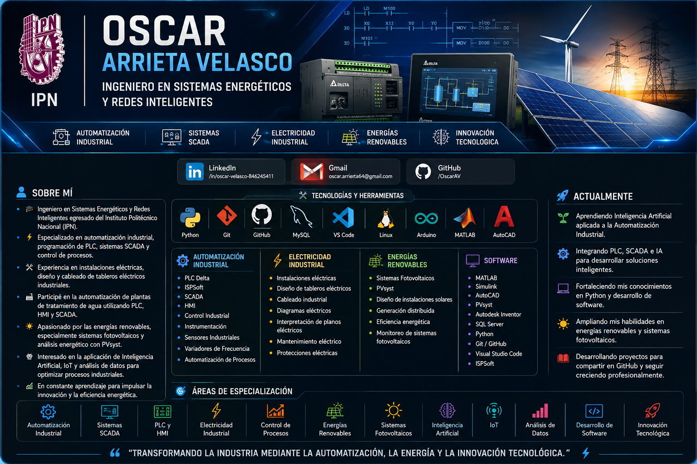

 

  

<h1 align="center">⚡ Oscar Arrieta Velasco</h1>

<h3 align="center">Ingeniero en Sistemas Energéticos y Redes Inteligentes | IPN</h3>

  Automatización Industrial · PLC · HMI · SCADA · BESS · Energías Renovables · CAD · IoT

  
  
  

---

## 👨‍💻 Sobre mí

Soy Ingeniero en Sistemas Energéticos y Redes Inteligentes, egresado del Instituto Politécnico Nacional (IPN). Mi perfil integra la ingeniería eléctrica, la automatización industrial, la programación y las energías renovables.

Tengo experiencia en instalaciones eléctricas industriales y en proyectos de automatización de plantas de tratamiento de aguas residuales mediante PLC Delta, HMI y sistemas de control.

Este portafolio reúne documentación técnica, programas, planos, modelos CAD y proyectos de ingeniería.

- ⚙️ Automatización industrial y control de procesos.
- 💻 Programación de PLC, lógica Ladder y HMI.
- ⚡ Instalaciones eléctricas industriales y tableros.
- ☀️ Sistemas fotovoltaicos y análisis energético.
- 🔋 Sistemas BESS y almacenamiento de energía.
- 🚁 Inspección de infraestructura eléctrica mediante drones.
- 🌐 Sensores, sistemas embebidos e IoT.

---

# 📂 Mi portafolio

Selecciona una categoría para consultar los archivos y materiales que voy publicando.

<table>
  <tr>
    <td width="50%" valign="top">
      <h3>📚 Artículos</h3>
      Investigaciones, informes y documentación técnica.

      - BESS y almacenamiento energético.
      - NFPA 855, UL 9540 y UL 9540A.
      - Energía fotovoltaica.
      - Automatización industrial.

      <a href="./ARTICULOS/">📂 Abrir artículos</a>
    </td>
    <td width="50%" valign="top">
      <h3>📐 Planos eléctricos</h3>
      Diagramas y documentación de ingeniería.

      - Diagramas unifilares.
      - Tableros eléctricos.
      - Fuerza y control.
      - Instalaciones fotovoltaicas.

      <a href="./PLANOS/">📂 Abrir planos</a>
    </td>
  </tr>
  <tr>
    <td width="50%" valign="top">
      <h3>💻 Programaciones</h3>
      Código fuente y automatización.

      - PLC Delta y Ladder.
      - Python, C y C++.
      - Arduino y ESP32.
      - MATLAB y SQL.

      <a href="./PROGRAMACIONES/">📂 Abrir programaciones</a>
    </td>
    <td width="50%" valign="top">
      <h3>🧊 Diseños 3D</h3>
      Modelos mecánicos y prototipos.

      - Autodesk Inventor.
      - Modelos STL y STEP.
      - Soportes y carcasas.
      - Diseños de drones.

      <a href="./DISENOS-3D/">📂 Abrir diseños 3D</a>
    </td>
  </tr>
</table>

---

# 🚀 Proyectos de ingeniería

Mis proyectos están organizados en repositorios independientes para conservar sus archivos, documentación y código.

## ⚙️ Automatización industrial

### 01. Planta de tratamiento de aguas residuales — Querétaro

Automatización y control mediante PLC Delta para la operación de bombas y el monitoreo de medidores de flujo.

**Tecnologías:** Delta, ISPSoft, Ladder y HMI.

[📂 Ver proyecto](https://github.com/OSCAR-ARRIETA/AUTOMATIZACION-PLC-QUERETARO)

### 02. Planta de tratamiento de aguas residuales — Guanajuato

Proyecto independiente de automatización y supervisión de procesos industriales mediante PLC Delta, lógica de control e interfaces HMI.

**Tecnologías:** Delta, ISPSoft, DOPSoft y Ladder.

[📂 Ver proyecto](https://github.com/OSCAR-ARRIETA/AUTOMATIZACION-PLC-GUANAJUATO)

---

## ☀️ Energías renovables

### 03. Diseño de sistema fotovoltaico con PVsyst

Diseño y simulación de un sistema fotovoltaico para analizar su generación y evaluar alternativas de aprovechamiento de la energía solar.

**Tecnologías:** PVsyst y análisis energético.

[📂 Ver proyecto](https://github.com/OSCAR-ARRIETA/DISENO-SISTEMA-FOTOVOLTAICO-PVSYST)

---

## 🚁 Inspección inteligente

### 04. Dron para inspección de infraestructura eléctrica

Propuesta de diseño e integración de un dron para inspección fotovoltaica con cámara térmica, GPS y sensores ambientales, orientado a identificar posibles puntos calientes.

**Tecnologías:** ESP32-S3, visión térmica, GPS e IoT.

[📂 Ver proyecto](https://github.com/OSCAR-ARRIETA/DRON-INSPECCION-INFRAESTRUCTURA-ELECTRICA)

---

## ⚡ Electricidad industrial

### 05. Experiencia profesional como electricista industrial

Documentación de trabajos de instalación eléctrica, tubería conduit, cableado de fuerza y control, montaje de tableros y conexión de equipos industriales.

[📂 Ver experiencia](https://github.com/OSCAR-ARRIETA/ELECTRICISTA-INDUSTRIAL)

---

# 🛠️ Tecnologías y herramientas

  

### Automatización y control
- PLC Delta, ISPSoft y lógica Ladder.
- DOPSoft, HMI y supervisión industrial.
- Instrumentación, sensores y actuadores.
- Variadores de frecuencia y control de bombas.

### Electricidad industrial
- Instalaciones eléctricas y tubería conduit.
- Tableros y cableado industrial.
- Diagramas de fuerza y control.
- Conexión de motores y equipos.

### Energía y diseño
- Sistemas fotovoltaicos y PVsyst.
- AutoCAD y Autodesk Inventor.
- Análisis energético.
- Documentación técnica.

### Programación y electrónica
- Python, C y C++.
- MATLAB y Simulink.
- SQL.
- Arduino y ESP32.
- Git y GitHub.

---

# 📫 Contacto

Estoy interesado en oportunidades y proyectos relacionados con automatización industrial, ingeniería eléctrica, almacenamiento energético y energías renovables.

  
  

<h3 align="center">
  ⚡ Transformando la industria mediante la automatización, la energía y la innovación tecnológica.
</h3>
